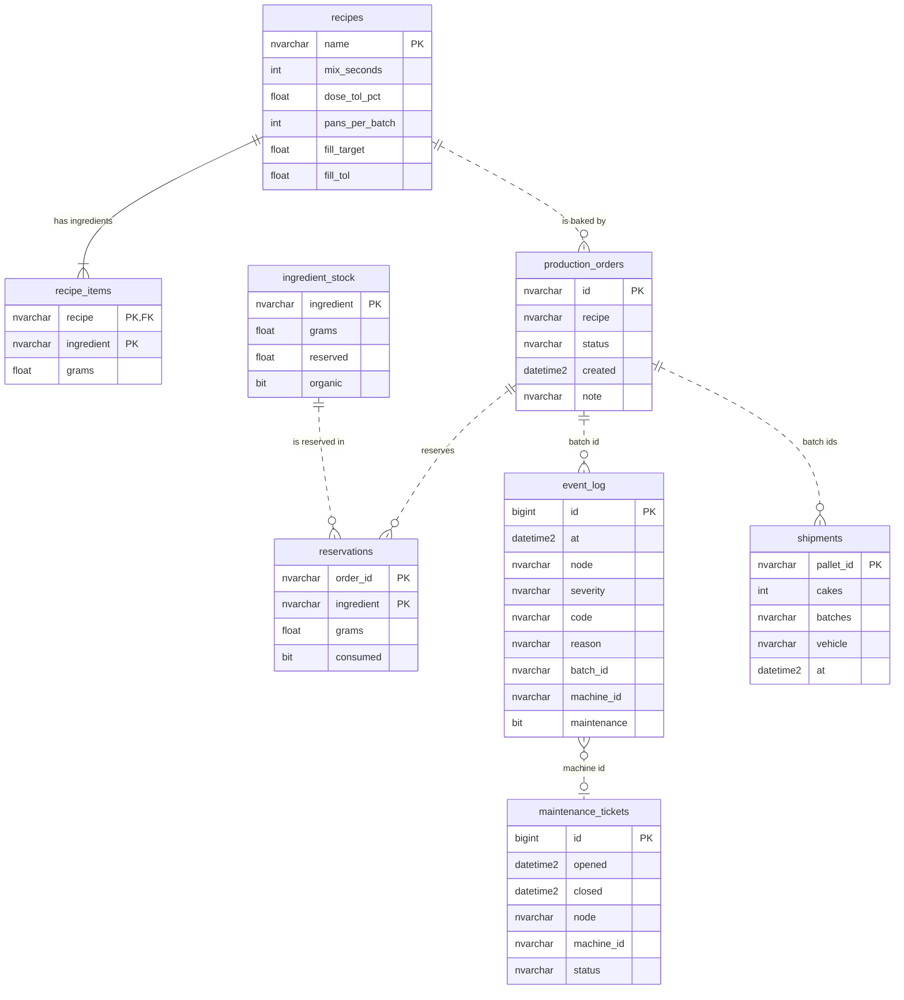

# Exercise 6.4: Databases

Draft for the report. The schema is in `internal/store/sql_mssql.go`, the document
model in `internal/model/model.go`.

## Decision

- **Microsoft SQL Server (SQL)** for the main system: recipes, ingredient stock,
  reservations, orders, shipments, the event log (traceability) and maintenance
  tickets.
- **MongoDB (NoSQL)** for what travels through the experiment: one document per
  simulated pan (and per cake after depanning), and one state snapshot per node.
  Without Docker the same interface stores each pan as a JSON file.

## Per system and subsystem

| System | Subsystem | Data | Database | Why |
|---|---|---|---|---|
| PLM | Order & Scheduling | production orders, status | SQL Server | fixed fields, one order has many reservations |
| PLM | Recipe Management | recipes and ingredient targets and tolerances | SQL Server | read by key, rarely edited, one recipe has many items |
| PLM | Warehouse & Inventory | stock, reservations | SQL Server | needs a transaction: two orders must not reserve the same stock (`Reserve` locks rows, checks the organic rule, updates stock) |
| PLM | Transport & Shipment | shipments (pallet, cakes, batches, vehicle) | SQL Server | traceability, joins to batches |
| MON | Traceability & Event Logging | every log, warning, error and discard event with batch id | SQL Server | append-only, queried by batch, time, reason; aggregates for waste figures and recall |
| MON | Maintenance Management | tickets | SQL Server | status changes, history |
| BAT, THM, FIN | all subsystems | the pans and cakes in motion: station, status, fill weight, temperature, history | MongoDB | a pan is a self-contained document that each station updates in turn; the history array travels with it; structure changes as stations are added |
| every node | state | counters and gauges saved every 3 s | MongoDB | reloaded after a restart (THM deployment table: "last saved state is loaded") |
| every node | event outbox | events not yet acknowledged by the broker | local file (JSON) | must survive a restart without a database (THM-REQ-77) |

## ER diagram (SQL Server)

Only the solid line (recipes to recipe_items) is a declared foreign key. Dotted lines are references by id that the database
does not enforce (the batch id is created by PLM with the order and travels in every
message, so it is not a table of its own).



Note: in the code only `recipe_items.recipe` is a declared foreign key
(to `recipes`). The links from `reservations`, `production_orders`, `event_log` and
`shipments` are by id, which is why a recall query joins them by batch id in the
application. Adding the foreign keys is possible if the group wants the database to
enforce them.

## Data models

SQL Server (tables of `sql_mssql.go`):

```
recipes(name PK, mix_seconds, dose_tol_pct, pans_per_batch, fill_target, fill_tol)
recipe_items(recipe FK, ingredient, grams)            PK(recipe, ingredient)
ingredient_stock(ingredient PK, grams, reserved, organic)
reservations(order_id, ingredient, grams, consumed)   PK(order_id, ingredient)
production_orders(id PK, recipe FK, status, created, note)
shipments(pallet_id PK, cakes, batches, vehicle, at)
event_log(id PK, at, node, device, severity, code, reason, batch_id, machine_id, maintenance)
maintenance_tickets(id PK, opened, closed, node, machine_id, reason, status)
```

Relations: recipe 1-n recipe_items; order 1-n reservations (per ingredient); event_log
and shipments refer to batches by id (the batch id is created by PLM with the order).

MongoDB, collection `pans` (pans and cakes):

```json
{ "_id": "PAN-001", "batchId": "B0004", "station": "FIN-Depanning", "status": "depanned",
  "fillWeight": 447.0, "cakeTemp": 23.6, "updated": "...",
  "history": [ { "at": "...", "station": "THM-Depositing", "status": "filled", "note": "447.0 g batter" } ] }
```

Cake documents are `CAKE-<batch>-<pan>` with a `panId`. Collection `node_state`:
`{ "_id": "THM", "state": { "deposited": 120, ... }, "at": "..." }`.

Traceability (batch to pans to cakes to pallets) joins the event log, the pan
documents and the shipments by batch id; a full recall query is not implemented.

## Options considered

| Option | For | Against here |
|---|---|---|
| SQL Server (chosen) | ACID, joins, group's choice | Windows-centric, x86 image, licence |
| PostgreSQL / MySQL | free, light | not the group's choice; equal fit technically |
| MongoDB (chosen for pans) | document per pan, flexible, easy to inspect | no joins; weaker consistency across documents |
| SQLite per service | no server, no network on the control path | each service has its own file; lecture draft's choice for service state |
| Redis | very fast | persistence needs care; no queries |
| Cassandra | huge scale | far beyond the load; hard to operate |

## Impact on the quality attributes

- **Data integrity:** stock reservation is one SQL transaction with an application
  lock for the schema creation; the organic-ingredient rule is enforced there.
- **Availability:** the control path does not wait for a database. The monitor queues
  its SQL writes and retries (verified: SQL Server off for 30 s, no node declared
  dead, nothing halted); stations time document calls out after 3 s and carry on
  (verified with MongoDB off). While MongoDB is off the documents are not updated.
- **Recovery:** queues are rebuilt from the pan and cake documents after a restart.
- **Modifiability:** a new station only adds statuses to the pan document; no schema
  change.
- **Scalability:** SQL Server and MongoDB both handle far more than 50 writes per
  second; not tested beyond the demo load. Single instances, no replication.
- **Complexity:** two database technologies and two query styles (the lecture draft
  warns about this). Accepted because the group decided it and the split is clean:
  relational data in SQL, traveling documents in MongoDB.
