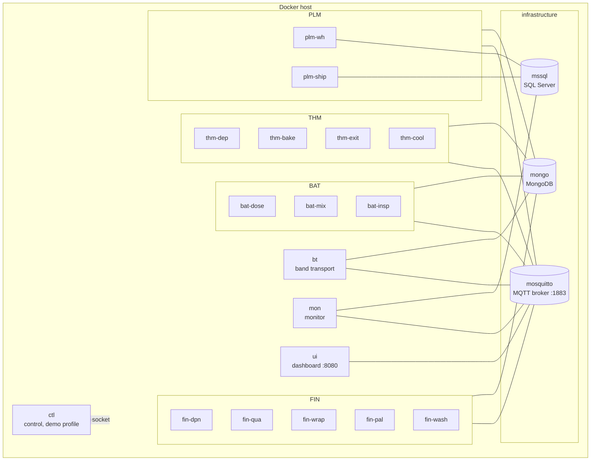

# Deployment view

One image holds all stations; Docker Compose starts one container per station, plus the broker, the two
databases, the dashboard and the optional control service. This is the view for the report (a Papyrus deployment
diagram would show the same nodes).

| Node | Image | State on a volume | Talks to |
|---|---|---|---|
| 14 stations, `bt`, `mon` | one image (`cmd/station`, `cmd/bt`, `cmd/mon`), the node is chosen by an environment variable | outbox and saved queues (`*-data`) | broker; SQL (PLM, MON); MongoDB (pan and cake documents, saved queues) |
| `mosquitto` | eclipse-mosquitto | persistent sessions | every node |
| `mssql` | SQL Server 2022 | `mssql-data` | PLM, MON |
| `mongo` | MongoDB | `mongo-data` | stations |
| `ui` | `cmd/ui` | none | broker, MON API, SQL |
| `ctl` | `cmd/ctl` (profile `demo`) | none | Docker socket |

Start: `docker compose up -d --build` (`docker compose --profile demo up -d --build` adds `ctl`). A container that
exits is restarted by Docker (`restart: unless-stopped`); after the restart it is reborn on the broker and takes up
its pans and cakes from the stored documents ([stations.md](stations.md), [containers.md](containers.md)). CI
builds and pushes the images to ghcr.io from `master`; there is no deploy job because there is no target machine
(decision 24 Nov: the compose file is the deployment).
