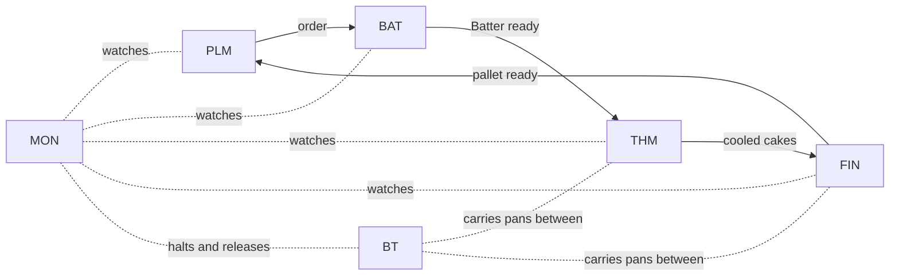

# The UPPAAL diagrams explained from zero

This guide is for someone who has never seen UPPAAL and does not know our system. After
reading it you should be able to open any of the four models, read the diagram, understand
what the queries prove, and know what the models do **not** prove.

Contents: [1. The system](#1-the-system-in-two-minutes) ·
[2. Timed automata](#2-timed-automata-in-five-minutes) ·
[3. Queries](#3-queries-how-uppaal-checks-a-claim) ·
[4. Why the diagrams look like this](#4-why-the-diagrams-look-like-this) ·
[5. The four models](#5-the-four-models) · [6. Results and limits](#6-what-the-results-mean-and-their-limits) ·
[7. How to use the files](#7-how-to-open-run-and-change-the-models) · [8. Glossary](#8-glossary)

---

## 1. The system in two minutes

We built (in Go) a simulated **cake factory**. It has six systems, and each station runs in
its own Docker container:

| System | What it does |
|---|---|
| **PLM** | Production planning: releases orders, reserves ingredients, ships pallets. |
| **BAT** | Batter preparation: dosing, mixing, inspection, then the handoff of the batter. |
| **THM** | Thermal processing: depositing batter into pans, baking, cooling. |
| **FIN** | Finishing: depanning, inspecting, wrapping, cartoning, washing pans. |
| **BT** | Band Transport: five conveyor sections that carry the pans between stations. |
| **MON** | The monitor: watches every container, halts the band, raises tickets for Maintenance. |



Four things matter for the diagrams:

1. **Messages.** Stations talk through an MQTT message broker (Mosquitto) using the Sparkplug B
   convention. Every station announces itself with a **birth** message when it starts, sends a
   **heartbeat** every 5 seconds while it is alive, and the broker publishes a **death
   certificate** (also called a *Last Will*) when a station disappears.
2. **Failures are normal.** A station can **crash** (the process dies, the broker notices at
   once) or **freeze** (the process hangs and goes silent, the broker notices only when the
   heartbeats stop). MON sees the death certificate and Docker restarts the container.
3. **Time limits are requirements.** For example: a stopped station must be noticed within 15 s
   and be back within 60 s. These come from the project requirements (THM-REQ-72 and -73).
4. **Handoffs.** When a station finishes a pan or a batch it writes a document to the database
   and sends a message to the next station. If the message is lost, the next station finds
   the document anyway by scanning every 5 seconds.

The full system is described in `docs/stations.md`, `docs/signals.md` and `docs/decisions.md`.

### Why UPPAAL at all?

Exercise 8 asks us to take the timing rules of the architecture and **prove** them on a
formal model, not only measure them in one experiment. A test can show that a rule held in
270 runs. A model checker explores **every** possible behaviour of the model, including the
unlucky ones, and tells us whether a rule can ever be broken.

---

## 2. Timed automata in five minutes

A **timed automaton** is a small state machine that also has **stopwatches** (clocks). UPPAAL
draws and checks them.

### The pieces

| Piece | How it looks | What it means |
|---|---|---|
| **Location** | circle with a name | A state the part can be in. Example: `Online`, `Down`. |
| **Initial location** | circle inside a circle | Where the part starts. |
| **Committed location** | circle with a `C` | Time may not pass here; the next step happens at once. Used for "instant" steps. |
| **Edge** | arrow between locations | A transition from one state to another. |
| **Clock** | a variable like `x` | A stopwatch. It runs by itself; it only goes back to 0 when an edge says `x = 0`. |
| **Invariant** | text under a location, e.g. `x <= 5` | "You may stay here only while this is true." It **forces** the automaton to move on. |
| **Guard** | green text on an edge, e.g. `x >= 5` | "You may take this edge only when this is true." It **holds** the move back. |
| **Synchronisation** | teal text on an edge, e.g. `hb!` or `hb?` | A message between two automata. `!` sends, `?` receives. Both move at the same moment. |
| **Update** | blue text on an edge, e.g. `x = 0` | What happens when the edge is taken: reset a clock, set a variable. |
| **Select** | olive text, e.g. `k : id_t` | Pick any value in a range (used to say "any of the five sections"). |

### How the two time pieces work together

An **invariant** is a deadline and a **guard** is the earliest moment. Together they make a
time window:

```
Online   invariant  x <= 5        "may not stay longer than 5 s"
edge     guard      x >= 5        "may leave only after 5 s"
         sync       hb!           "and sends a heartbeat"
         update     x = 0         "then restarts the stopwatch"
```

Read together: *the node sends exactly one heartbeat every 5 seconds.* A window such as
`d >= 1` with invariant `d <= 30` means *"takes anywhere between 1 and 30 seconds"*. UPPAAL
checks **every** value in that window, not just one.

### Several automata form a network

Our systems have several parts (node, broker, monitor, …). Each part is one automaton called
a **template**. Together they form a **network of timed automata** (NTA). They talk through
**channels**:

- **Binary channel** (`chan`): one sender, one receiver, they move together. If nobody is ready
  to receive, the sender **waits**.
- **Broadcast channel** (`broadcast chan`): one sender, any number of receivers (also zero).
  Everybody who can listen moves with the sender; the sender never waits.

### Reading one diagram in thirty seconds

Take the heartbeat part of the **Node** template:

```
            hb! , x >= HB , x = 0
         ┌───────────────────────┐
         ▼                       │
      ( Online )  x <= HB ───────┘
```

It has one location with an invariant (stay at most 5 s) and one edge back to itself that is
allowed only after 5 s. So: stay 5 s, send a heartbeat, restart the clock, repeat forever.

---

## 3. Queries: how UPPAAL checks a claim

A model alone proves nothing. We also write **queries**, claims about the model, and UPPAAL
answers *satisfied* or *NOT satisfied*.

| Query form | Reads as | Example from our models |
|---|---|---|
| `A[] p` | "**always** p, in every reachable state" | `A[] not MON.Escalated`: MON never escalates. |
| `E<> p` | "p is **reachable**: some run gets there" | `E<> Batch.Discarded`: a discard can happen. |
| `p --> q` | "whenever p, **eventually** q" | `Node.Down --> Node.Online`: every failure ends in recovery. |
| `A[] not deadlock` | "the system never gets stuck" | Used in every model. |

Why we always add `E<>` queries: an `A[]` claim is also true if the situation never happens
at all ("always true because nothing ever occurs"). `E<> Node.Down` shows the failure really
can happen, so the `A[]` claims about it mean something.

**Negative controls.** To show a query can fail, we change one number and check that it does
fail. For example, if Docker may take 60 s to restart instead of 30 s, the "back within 60 s"
query becomes NOT satisfied. If a check cannot fail, it proves nothing.

---

## 4. Why the diagrams look like this

You will notice the layout looks mechanical. That is on purpose.

- **The files are generated.** `gen.js` writes `supervision.xml`, `band.xml`, `batter.xml`,
  `handover.xml` and the matching `.q` query files. We do not draw by hand, so the diagram
  always matches the numbers and queries in the documents.
- **Locations sit on an ellipse**, in the order they are listed in `gen.js`. The position has
  **no meaning**. It only avoids overlap. (For crowded diagrams, such as `Dep` in the batter
  model, a location can be placed by hand with `at`.)
- **The name is below the circle and the invariant below the name.**
- **Several edges between the same two locations bend to opposite sides**, so two arrows going
  in opposite directions do not lie on top of each other.
- **Self-loops** (an edge from a location to itself) are stacked above the location.
- **Labels** are placed beside their edge. Colours are UPPAAL's: green guard, teal
  synchronisation, blue update, olive select, purple invariant.
- **Every model except `supervision` has a tiny `Tick` template**: one location with a loop to
  itself. UPPAAL calls a state with no way forward a *deadlock*. When a model has finished its
  story, it would count as a deadlock and `A[] not deadlock` would fail for a boring reason.
  `Tick` lets time keep passing.

---

## 5. The four models

Each model checks **one part** of the system (see `docs/verification-scope.md` for why these
four). All times are in seconds. Values marked *estimated* are guesses, because the plant does
not give them (our measured restart is at most 1.2 s, so the estimates are on the safe side).

### 5.1 Supervision (`supervision.xml`): is a failed station noticed and restored in time?

**The story.** A station (the *Node*) sends a heartbeat every 5 s. The *Broker* watches it. At
some moment the environment makes the node **crash** or **freeze**. The broker publishes a
death certificate, MON hears it and starts a timer, Docker restarts the node, the node sends a
birth message, and MON is satisfied again. If the node were not back in 45 s, MON would
escalate to Maintenance.

**Templates:**

| Template | Locations | What it does |
|---|---|---|
| **Node** | `Starting`, `Online`, `Down` | `Online`: sends `hb!` every 5 s. `crash?` or `freeze?` moves it to `Down`. `restart?` moves it to `Starting` (must finish within 1 s), then it sends `birth!`. |
| **Broker** | `Alive`, `Notify` (committed), `Dead` | Each `hb?` resets its clock `y`. A **crash** gives an immediate death certificate (through the committed `Notify`). A **freeze** is silent, so the invariant `y <= DEADAFTER` forces the certificate after 8 s without a heartbeat. `birth?` returns it to `Alive`. |
| **MON** | `Watching`, `Failed`, `Escalated` | `ndeath?` starts the stopwatch `z`. `birth?` ends the failure. If `z` reaches 45 s it escalates. |
| **Docker** | `Idle`, `Restarting` | After it hears `ndeath?` it restarts the node after 1 to 30 s (estimated). |
| **Env** | `Idle`, `Faulted` | The fault source: sends `crash!` or `freeze!` once and resets the observer clock `t`. |

**Parameters:**

| Name | Value | Meaning |
|---|---|---|
| `HB` | 5 | Heartbeat period. |
| `DEADAFTER` | 8 | The broker declares a node dead after 1.5 × the 5 s keep-alive = 7.5 s (rounded up). |
| `DETECT` | 15 | Detection limit from the requirements (THM-REQ-72). |
| `RESTORE` | 60 | Recovery limit (THM-REQ-73). |
| `ESCALATE` | 45 | MON escalates after this. |
| `RDMIN`, `RDMAX` | 1, 30 | Docker restart time, *estimated*. |
| `t` | clock | An observer: time since the fault. It is not part of any station. |

**What the queries prove:** a silent node is known to MON within 8 s (so inside the 15 s
limit); the node is back within 60 s; MON never escalates (its 45 s count starts at the death certificate, and a restart takes at most 30 s plus 1 s to boot); every
failure ends in recovery; no deadlock; and failures and recoveries are reachable.

### 5.2 Band (`band.xml`): does a halt reach every upstream station, and is it released safely?

**The story.** Five conveyor sections S1 to S5 carry pans. If the owner of section *k* fails,
that section halts, and everything **upstream** of it must stop taking new pans, otherwise
pans pile up. When the owner is back, MON releases the stopped sections, but only then.

**Templates:**

| Template | What it does |
|---|---|
| **Section(i)** (five copies) | `Running` → `Pass` when it gets `halt[i]?` (its own owner failed) or `stop[i]?` (the section downstream stopped). In `Pass` (invariant `x <= HOP`) it must hand the stop upstream within 1 s with `stop[i-1]!`. Then it is `Stopped`. `release?` returns it to `Running`. |
| **Env** | Picks **any** section with `select k : id_t`, sends `halt[k]!`, stays down for 1 to 30 s, then the owner is back. |
| **MON** | Sends `release!` only when `faulted && ownerUp[hk] && nstopped == hk + 1`: the owner is back **and** every upstream section is confirmed stopped. |

**Parameters:** `N = 5` sections (index 0 is the most upstream), `HOP = 1` (each section
passes the halt on within 1 s, THM-REQ-76/78), `RDMIN`/`RDMAX = 1/30` (owner restart,
*estimated*). Variables: `hk` (the failed section), `nstopped` (how many are stopped now),
`ownerUp[]`, `faulted`, `released`. `stop[N]` is a sink so section 0 has something to send to.

**What the queries prove:** after at most N × HOP = 5 s exactly `hk + 1` sections are stopped
(the failed one and everything upstream); each section passes the stop on within 1 s; the
release never happens before the owner is back; after the release nothing stays stopped; never
more sections stopped than are upstream; release is reachable.

### 5.3 Batter (`batter.xml`): can batter wait too long?

**The story.** A batch is mixed (6 s) and inspected (3 s). Then BAT-INSP must hand it to
depositing (THM-DEP). Depositing can be **stopped** (a jam, FC7). Batter must not wait for ever,
so after 25 s (parameter **P3**) of waiting the batter is discarded.

An important detail: **there is no acknowledgement** from depositing. BAT-INSP never asks "did
you take it?". It keeps its own **copy** of the "depositing stopped / working again" state and
acts on that. If the copy says working, it sends "Batter ready" and is done. This matches the
code (`internal/bat/insp.go`) and is the group decision recorded in `TODO.md` item 7.

**Templates:**

| Template | What it does |
|---|---|
| **Batch** (BAT-INSP) | `Mixing` (6 s) → `Inspecting` (3 s) → either `Handed` (copy says working: sends `ready!`) or `Holding` (copy says stopped). In `Holding` it waits at most `P3 + POLL`: it goes to `Handed` when the copy says working again, otherwise to `Discarded`. |
| **Dep** (THM-DEP) | `Open` or `Blocked` (stopped, at most 60 s). It queues a batter whatever its state (`OpenQ`) and takes it up within 5 s once it admits pans (`Took`, a committed location). It can stop only once. |
| **Copy** | BAT-INSP's copy of the state: every 1 to 6 s it copies the real state (`seen = stopped`). So the copy can be a little **stale**. |

**Parameters:** `MIX = 6`, `INSP = 3`, `P3 = 25`, `POLL = 1` (the code looks at the state once
a second, so it really discards after 26 s), `LOST = 120` (dosing gives up on a batch after 120
s), `STALE = 6` (the copy is at most one heartbeat plus one delivery old, *estimated*),
`BLOCKMAX = 60` (depositing stays stopped at most this long, *estimated*), `DEPSTART = 5`
(*estimated*). Clocks: `g` age of the batch, `h` time since the inspector approved it.

**What the queries prove:** before the handoff the batter holds at most 26 s; BAT's side of a
batch is finished within 35 s; a batter is always deposited before dosing gives the batch up
(120 s); deposited and discarded never both happen; both ends are reachable.

**Two findings** (satisfied queries that show a weakness rather than a safety guarantee):

1. The state copy can be stale: a batter can be handed over while depositing is already
   stopped. Depositing queues it, so nothing is lost.
2. After the handoff **nothing limits the wait**: a batter can be deposited up to 70 s after
   approval, longer than P3. The 25 s rule is only enforced before the handoff. This is
   documented in `docs/team-review.md` section 3, item 11, with a proposed fix.

### 5.4 Handover (`handover.xml`): is a lost message harmless?

**The story.** Station A finishes a pan, **stores a document** (the truth) and then sends a
message (the trigger) to station B. The message may be lost. Station B also **scans** the
documents every 5 seconds and takes up any that are older than a 3 s grace period. So even a
lost message cannot lose a pan.

**Templates:**

| Template | What it does |
|---|---|
| **Sender** | `Idle` → `Stored` (committed: the document is written first) → `Signalled` (`handoff!`). The order document-then-message is rule T-OR1. |
| **Message** | `Idle` → `Flight` (at most 1 s) → either `Delivered` (`deliver!`) or `Lost`. Both branches are possible, so the model covers the bad case. |
| **Receiver** | Takes the document at once on `deliver?`. Otherwise, at each scan (invariant `r <= RECONCILE`) it takes any document that is older than the grace period (`a >= GRACE`). The two self-loops are scans that find nothing. |

**Parameters:** `GRACE = 3`, `RECONCILE = 5` (both from the code), `DELMAX = 1` (message
delay, *estimated*). Clock `a`: time since the document was stored.

**What the queries prove:** a stored document is always taken up within GRACE + RECONCILE = 8 s
(worst case: a scan just before the grace period ends, then another one 5 s later), also when
the message is lost; and both the "lost then reconciled" and the "delivered" paths exist.

---

## 6. What the results mean, and their limits

| Model | Queries | Result |
|---|---|---|
| `supervision.xml` | 8 | all satisfied |
| `band.xml` | 7 | all satisfied |
| `batter.xml` | 11 | all satisfied (two of them are the findings above) |
| `handover.xml` | 4 | all satisfied |

**What this gives us.** For the modelled parts, the timing claims hold for **every** possible
behaviour within the stated parameters, not only for the runs we happened to try. The
measured experiment (`docs/experiment.md`) fits inside the proven bounds: detection at most
7.06 s against a proven 8 s, recovery at most 1.19 s against a proven 60 s.

**What it does not give us.**

- The models are written **by hand** from the code and the documents. They can drift from the
  code. They are not generated from it, and the UPPAAL check is **not part of the CI**.
- Each model has **one fault** (one node, one halt, one batch). Several failures at once are
  not covered.
- Estimated values (restart time, message delay, how long depositing may stay stopped) are
  assumptions. The proofs hold for those values only. They are safe, not tight.
- A model is an abstraction. For example, the batter model does not include the delivery
  delay of "Batter ready"; a message lost for good is caught by dosing's 120 s timer, which
  is only checked as a query, not modelled.
- "Satisfied" means the claim holds **in the model**. It does not prove the code is correct.

---

## 7. How to open, run and change the models

**Check all models from the command line** (UPPAAL's command-line verifier; no GUI needed):

```bash
node gen.js
verifyta -q supervision.xml supervision.q
verifyta -q band.xml band.q
verifyta -q batter.xml batter.q
verifyta -q handover.xml handover.q
```

On Windows `verifyta` is at `C:\Program Files\UPPAAL-5.0.0\app\bin\verifyta.exe`. Every line
should say `Formula is satisfied`.

**Look at the diagrams:** open the `.xml` in the UPPAAL GUI (click *Import* when it asks about
the query file). The *Editor* tab shows the templates; the *Verifier* tab runs the queries.
To see one automaton, click its name in the project tree on the left (drag the splitter to
widen it).

**Change a model:** edit `gen.js`, never the `.xml`, then run `node gen.js`.

> **Do not save from the UPPAAL GUI.** It overwrites the generated files with its own layout
> and format, and the next `node gen.js` is the only way back. If it happens,
> `git checkout -- <file>` and regenerate.

Files:

| File | What it is |
|---|---|
| `gen.js` | The generator: all constants, templates, positions and queries live here. |
| `*.xml` | Generated models (open in UPPAAL). |
| `*.q` | Generated query files. |

Related documents: `docs/timing-constraints.md` (D1, which rules exist), `docs/verification-scope.md`
(D2, what we verify and why), `docs/timed-automata.md` (D3, the same automata as tables),
`docs/team-review.md` (open decisions).

---

## 8. Glossary

| Term | Meaning |
|---|---|
| **NTA** | Network of timed automata: several templates that talk through channels. |
| **Template** | One automaton, usually one part (a station, the broker, the monitor). |
| **Location / state** | A circle in the diagram. |
| **Edge / transition** | An arrow. |
| **Clock** | A stopwatch variable that only grows and is reset by updates. |
| **Invariant** | A condition a location needs to stay in; forces the automaton to leave in time. |
| **Guard** | A condition an edge needs to be taken; holds the move back. |
| **Channel** | A named message line between automata; `!` sends, `?` receives. |
| **Broadcast channel** | A channel with one sender and any number of receivers; the sender never waits. |
| **Committed location** | A location where time may not pass; used for steps that happen instantly. |
| **Deadlock** | A state from which nothing can ever happen again. |
| **Query** | A claim about the model that UPPAAL checks (`A[]`, `E<>`, `-->`). |
| **Negative control** | Changing a number to make a query fail, to show that the query can fail. |
| **Heartbeat** | A "still alive" message every 5 s. |
| **Birth / death certificate** | The message a node sends when it starts / the message the broker sends when it disappears. |
| **Last Will** | MQTT's name for the death certificate. |
| **Crash / freeze** | The process dies (noticed at once) / the process hangs silently (noticed after the keep-alive). |
| **MON** | The monitor system. |
| **Estimated** | A value the plant does not give; chosen by the group and marked as such. |
