# The UPPAAL diagrams explained from zero

This guide is for someone who has never seen UPPAAL and does not know our system. After
reading it you should be able to open any of the four models, read the diagram, understand
what the queries prove, and know what the models do **not** prove.

Contents: [1. The system](#1-the-system-in-two-minutes) ·
[2. Timed automata](#2-timed-automata-in-five-minutes) ·
[3. Queries](#3-queries-how-uppaal-checks-a-claim) ·
[4. Why the diagrams look like this](#4-why-the-diagrams-look-like-this) ·
[5. The four models](#5-the-four-models) · [6. Results and limits](#6-what-the-results-mean-and-their-limits) ·
[7. How to use the files](#7-how-to-open-run-and-change-the-models) · [8. Glossary](#8-glossary)

---

## 1. The system in two minutes

We built (in Go) a simulated **cake factory**. It has six systems, and each station runs in
its own Docker container:

| System | What it does |
|---|---|
| **PLM** | Production planning: releases orders, reserves ingredients, ships pallets. |
| **BAT** | Batter preparation: dosing, mixing, inspection, then the handoff of the batter. |
| **THM** | Thermal processing: depositing batter into pans, baking, cooling. |
| **FIN** | Finishing: depanning, inspecting, wrapping, cartoning, washing pans. |
| **BT** | Band Transport: five conveyor sections that carry the pans between stations. |
| **MON** | The monitor: watches every container, halts the band, raises tickets for Maintenance. |

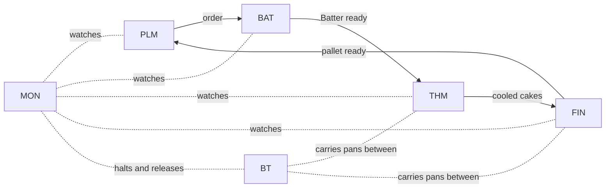

Four things matter for the diagrams:

1. **Messages.** Stations talk through an MQTT message broker (Mosquitto) using the Sparkplug B
   convention. Every station announces itself with a **birth** message when it starts and sends
   a **heartbeat** (a status message for MON) every 5 seconds while it is alive. Its MQTT
   connection also has a **keep-alive** of 5 seconds, which is a separate ping to the broker.
   When a station disappears, the broker publishes its **death certificate**, which the station
   registered when it connected (MQTT calls this the *Last Will*).
2. **Failures are normal.** A station can **crash** (the process dies, its connection closes, and
   the broker sends the death certificate at once; we measured about 0.3 s) or **freeze** (the
   container is paused: nothing is sent any more, and the broker declares it dead only after
   1.5 × the 5 s keep-alive = 7.5 s without traffic; we measured about 7 s). MON, on a death
   certificate, has Band Transport halt the conveyor sections of that station. Docker's restart
   policy (`restart: unless-stopped`) brings a **crashed** container back by itself. A **frozen**
   container is not restarted by Docker: in our experiments the scenario unpauses it. If a dead
   container has not been reborn after 45 s, MON opens a ticket for Maintenance.
3. **Time limits are requirements.** For example: a stopped station must be noticed within 15 s
   and be back within 60 s. These come from the project requirements (THM-REQ-72 and -73).
4. **Handoffs.** When a station finishes a pan or a batch it writes a document to the database
   and sends a message to the next station. If the message is lost, the next station finds
   the document anyway by scanning every 5 seconds.

The full system is described in `docs/stations.md`, `docs/signals.md` and `docs/decisions.md`.

### Why UPPAAL at all?

Exercise 8 asks us to take the timing rules of the architecture and **prove** them on a
formal model, not only measure them in one experiment. A test can show that a rule held in
270 runs. A model checker explores **every** possible behaviour of the model, including the
unlucky ones, and tells us whether a rule can ever be broken.

---

## 2. Timed automata in five minutes

A **timed automaton** is a small state machine that also has **stopwatches** (clocks). UPPAAL
draws and checks them.

### The pieces

| Piece | How it looks | What it means |
|---|---|---|
| **Location** | circle with a name | A state the part can be in. Example: `Online`, `Down`. |
| **Initial location** | circle inside a circle | Where the part starts. |
| **Committed location** | circle with a `C` | Time may not pass here; the next step happens at once. Used for "instant" steps. |
| **Edge** | arrow between locations | A transition from one state to another. |
| **Clock** | a variable like `x` | A stopwatch. It runs by itself; it only goes back to 0 when an edge says `x = 0`. |
| **Invariant** | text under a location, e.g. `x <= 5` | "You may stay here only while this is true." It **forces** the automaton to move on. |
| **Guard** | green text on an edge, e.g. `x >= 5` | "You may take this edge only when this is true." It **holds** the move back. |
| **Synchronisation** | teal text on an edge, e.g. `hb!` or `hb?` | A message between two automata. `!` sends, `?` receives. Both move at the same moment. |
| **Update** | blue text on an edge, e.g. `x = 0` | What happens when the edge is taken: reset a clock, set a variable. |
| **Select** | olive text, e.g. `k : id_t` | Pick any value in a range (used to say "any of the five sections"). |

### How the two time pieces work together

An **invariant** is a deadline and a **guard** is the earliest moment. Together they make a
time window:

```
Online   invariant  x <= 5        "may not stay longer than 5 s"
edge     guard      x >= 5        "may leave only after 5 s"
         sync       hb!           "and sends a heartbeat"
         update     x = 0         "then restarts the stopwatch"
```

Read together: *the node sends exactly one heartbeat every 5 seconds.* A window such as
`d >= 1` with invariant `d <= 30` means *"takes anywhere between 1 and 30 seconds"*. UPPAAL
checks **every** value in that window, not just one.

### Several automata form a network

Our systems have several parts (node, broker, monitor, …). Each part is one automaton called
a **template**. Together they form a **network of timed automata** (NTA). They talk through
**channels**:

- **Binary channel** (`chan`): one sender, one receiver, they move together. If nobody is ready
  to receive, the sender **waits**.
- **Broadcast channel** (`broadcast chan`): one sender, any number of receivers (also zero).
  Everybody who can listen moves with the sender; the sender never waits.

### Reading one diagram in thirty seconds

Take the heartbeat part of the **Node** template:

```
            hb! , x >= HB , x = 0
         ┌───────────────────────┐
         ▼                       │
      ( Online )  x <= HB ───────┘
```

It has one location with an invariant (stay at most 5 s) and one edge back to itself that is
allowed only after 5 s. So: stay 5 s, send a heartbeat, restart the clock, repeat forever.

---

## 3. Queries: how UPPAAL checks a claim

A model alone proves nothing. We also write **queries**, claims about the model, and UPPAAL
answers *satisfied* or *NOT satisfied*.

| Query form | Reads as | Example from our models |
|---|---|---|
| `A[] p` | "**always** p, in every reachable state" | `A[] not MON.Escalated`: MON never escalates. |
| `E<> p` | "p is **reachable**: some run gets there" | `E<> Batch.Discarded`: a discard can happen. |
| `p --> q` | "whenever p, **eventually** q" | `Node.Down --> Node.Online`: every failure ends in recovery. |
| `A[] not deadlock` | "the system never gets stuck" | Used in every model. |

Why we always add `E<>` queries: an `A[]` claim is also true if the situation never happens
at all ("always true because nothing ever occurs"). `E<> Node.Down` shows the failure really
can happen, so the `A[]` claims about it mean something.

**Negative controls.** To show a query can fail, we change one number and check that it does
fail. For example, if Docker may take 60 s to restart instead of 30 s, the "back within 60 s"
query becomes NOT satisfied. If a check cannot fail, it proves nothing.

---

## 4. Why the diagrams look like this

You will notice the layout looks mechanical. That is on purpose.

- **The files are generated.** `gen.js` writes `supervision.xml`, `band.xml`, `batter.xml`,
  `handover.xml` and the matching `.q` query files. We do not draw by hand, so the diagram
  always matches the numbers and queries in the documents.
- **Locations sit on an ellipse**, in the order they are listed in `gen.js`. The position has
  **no meaning**. It only avoids overlap. (For crowded diagrams, such as `Dep` in the batter
  model, a location can be placed by hand with `at`.)
- **The name is below the circle and the invariant below the name.**
- **Several edges between the same two locations bend to opposite sides**, so two arrows going
  in opposite directions do not lie on top of each other.
- **Self-loops** (an edge from a location to itself) are stacked above the location.
- **Labels** are placed beside their edge. Colours are UPPAAL's: green guard, teal
  synchronisation, blue update, olive select, purple invariant.
- **Every model except `supervision` has a tiny `Tick` template**: one location with a loop to
  itself. UPPAAL calls a state with no way forward a *deadlock*. When a model has finished its
  story, it would count as a deadlock and `A[] not deadlock` would fail for a boring reason.
  `Tick` lets time keep passing.

---

## 5. The four models

Each model is one file (`supervision.xml`, `band.xml`, `batter.xml`, `handover.xml`). Each file
contains several **diagrams**, one per template. The pictures below are screenshots from the
UPPAAL editor. In every picture, read the circles as states, the arrows as transitions, and the
coloured text as in the table of section 2.

### 5.0 Why every model is split into several diagrams

A model is not one big picture. It is a **network** of small automata that run at the same time
and only talk through channels. There are four reasons for splitting it:

1. **One diagram is one function block of the architecture.** Exercise 8 (D3.1) asks for the
   behaviour of each function block as its own timed automaton, and for the way they talk
   (D3.2) as a network. The Node is a station process, the Broker is the Mosquitto process, MON
   is the monitor container, and so on. Each of them fails and recovers on its own, so each has
   its own states and its own clocks.
2. **Each diagram stays small enough to read and to check.** The behaviour of the whole
   supervision protocol in one picture would have dozens of states. Split up, every diagram has
   two to five.
3. **Parts can be changed or repeated independently.** The `Section` diagram is drawn once and
   used five times (`Section(0)` to `Section(4)`, the parameter `i`). The restart time sits only
   in `Docker`, so the negative control of section 3 changes one number in one place.
4. **Some diagrams are not part of the factory but of its surroundings.** `Env` injects the
   fault, `Docker` restarts containers, `Message` is the network that may lose a signal, `Copy`
   is the delay of a state signal, and `Tick` only lets time pass. Keeping them apart from the
   real stations makes it clear which behaviour is the system and which is the assumption we
   test it against.

| Model | Parts of the factory | Surroundings and helpers |
|---|---|---|
| Supervision | `Node`, `Broker`, `MON` | `Docker` (restarts), `Env` (injects the fault) |
| Band | `Section` (×5), `MON` | `Env` (injects the fault), `Tick` |
| Batter | `Batch` (BAT-INSP), `Dep` (THM-DEP) | `Copy` (state signal delay), `Tick` |
| Handover | `Sender`, `Receiver` | `Message` (the network, may lose), `Tick` |

### Why each model has this cast, and not more

**The rule:** a part is in a model only if the claim we check depends on its behaviour. Everything
else is left out. A model that tried to contain the whole factory could not be checked, and
could not be read. So each model answers **one question**, and its cast is the smallest one that
can answer it.

| Model | The question | In the model, because the answer depends on it | Left out, because it does not |
|---|---|---|---|
| Supervision | Is a stopped station noticed within 15 s and back within 60 s? | `Node` (what fails), `Broker` (it issues the death certificate), `MON` (the requirement is about what MON knows, and it escalates), `Docker` (the time to restart is part of the 60 s), `Env` (the fault) | Pans, batter, band. Nothing in the timing of detection and restart depends on what the station produces. |
| Band | Does a halt reach every upstream section in time, and is it released only after the owner is back? | `Section` ×5 (the chain), `Env` (which owner fails), `MON` (it decides the release) | `Node`, `Broker` and `Docker`. How fast a failure is **noticed** is already proved in the supervision model, so this model starts at "the owner has failed". The owner's restart is reduced to one interval, 1 to 30 s, inside `Env`. |
| Batter | Can batter wait for depositing for too long? | `Batch` (BAT-INSP), `Dep` (THM-DEP), `Copy` (BAT's delayed knowledge of `Dep`) | `MON`, `Docker` and a separate `Env`. MON is not part of the handoff. The only fault is depositing being stopped, and that is built into `Dep` itself (`Blocked`, once). A stop does not restart the container, so there is no Docker; the stop time is only the estimated limit `BLOCKMAX`. |
| Handover | Is a lost message harmless? | `Sender`, `Receiver`, `Message` (it can lose) | `MON`, `Docker`, `Env`. The only fault is the lost message, and that is the `Lost` branch of `Message`. |

Three things follow from this:

- **Docker is only in the supervision model** because that is the only place where *restart
  time* is a result we need. Elsewhere it is absorbed into a plain time interval.
- **MON appears twice, with different jobs.** In the supervision model it is the *observer*: it
  starts a timer when a death certificate arrives and escalates after 45 s. In the band model it is
  the *decision maker*: it releases the sections. It is the same real container, but each model
  keeps only the half of its behaviour that the question needs.
- **The models are separate on purpose, and that is also a limit.** Detection time (supervision)
  plus halt time (band) are proved separately. Nobody has checked the two together in one model,
  for example a failure while another halt is already being released. Section 6 lists this
  among the limits.

Where a diagram sits on the screen (which circle is on top, which is on the left) has no
meaning. See section 4.

All times are in seconds. Values marked *estimated* are guesses, because the plant does not give
them (our measured restart is at most 1.2 s, so the estimates are on the safe side).

---

### 5.1 Supervision (`supervision.xml`): is a failed station noticed and restored in time?

**The story.** A station (the *Node*) sends regular traffic every 5 s. The *Broker* watches it. At
some moment the environment makes the node **crash** or **freeze**. The broker publishes a
death certificate, MON hears it and starts a timer, the container is brought back (Docker does it
for a crash, the experiment unpauses it for a freeze), the node sends a birth message, and MON is
satisfied again. If the node were not back in 45 s, MON would escalate to Maintenance.

**Two simplifications to know about.** (1) As in the code, the restart does not wait for MON or
for the death certificate: Docker acts when the process exits, so in the model `Docker` starts at
the fault itself. For a **crash** that is the real restart policy. For a **freeze** nobody restarts
the container: someone has to unpause it (in our experiments the scenario does). The delay of 1 to
30 s then stands for how long the pause lasts. That value is an **assumption** (in the plant it
would be the response of Maintenance), not something in the code. (2) MON has a second way to
notice a silent station: its own watchdog (3 missed heartbeats = 15 s, FC28). It is slower than
the broker's 7.5 s, so the model leaves it out.

**Parameters:**

| Name | Value | Meaning |
|---|---|---|
| `HB` | 5 | Period of the node's regular traffic: the heartbeat and the MQTT keep-alive ping are both 5 s in the code, so the model has one `hb`. |
| `DEADAFTER` | 8 | The broker declares a node dead after 1.5 × the 5 s keep-alive = 7.5 s (rounded up). |
| `DETECT` | 15 | Detection limit from the requirements (THM-REQ-72). |
| `RESTORE` | 60 | Recovery limit (THM-REQ-73). |
| `ESCALATE` | 45 | MON escalates after this. |
| `RDMIN`, `RDMAX` | 1, 30 | Docker restart time, *estimated*. |
| `t` | clock | An observer: time since the fault. It is not part of any station. |

#### Node (a station)

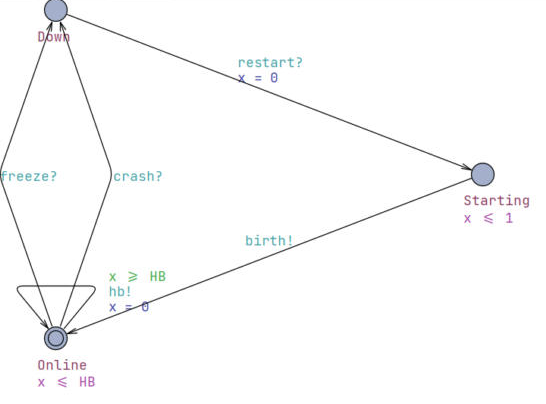

- `Online` is the starting state (double circle). Its invariant `x <= HB` and the loop guard
  `x >= HB` make the node send `hb!` (its regular traffic) exactly every 5 s and reset its clock.
- Two arrows go from `Online` to `Down`: `crash?` (the process dies) and `freeze?` (the container
  is paused). They are two different faults that look the same from the inside: the node is
  silent afterwards. They differ for the broker (see below).
- `Down` has no way out except `restart?` (the container is brought back), which leads to
  `Starting`. There the invariant `x <= 1` forces the node to announce itself with `birth!`
  within 1 s. (The 1 s boot time is an assumption; the measured recovery of a crashed station is
  at most 1.19 s in total.)

*Why it is its own diagram:* this is the behaviour of the station process. Every station runs
the same protocol, so this one picture stands for all of them. It knows nothing about brokers
or monitors; it only sends and receives.

#### Broker (the death certificate)

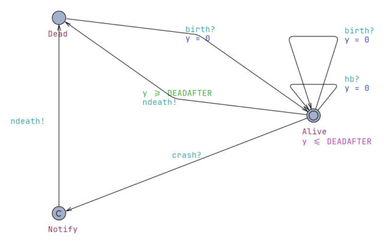

- In `Alive` every `hb?` resets the clock `y` (the loop). So does a `birth?` (the second loop):
  connecting again is traffic too. `y` is the MQTT keep-alive timer of the broker. The invariant `y <= DEADAFTER` means that the broker may not stay silent for more than 8 s
  (1.5 × the 5 s keep-alive = 7.5 s, rounded up).
- **A freeze** is silent: nothing arrives, so after 8 s the edge `y >= DEADAFTER` is taken and the
  broker sends `ndeath!` (the death certificate). That is the slow path (measured: about 7 s).
- **A crash** is fast: the connection closes and the Last Will fires at once. `crash?` leads to
  `Notify`, a committed state (the `C`), where time cannot pass, and then straight to `ndeath!`
  (measured: about 0.3 s).
- `Dead` waits for `birth?`, then returns to `Alive`.

*Why it is its own diagram:* the broker is a different process from the station. It keeps
running when the node dies, and that is exactly why it can notice the death. Its clock `y` measures
the silence of the node, something the node cannot measure about itself.

#### MON (the monitor)

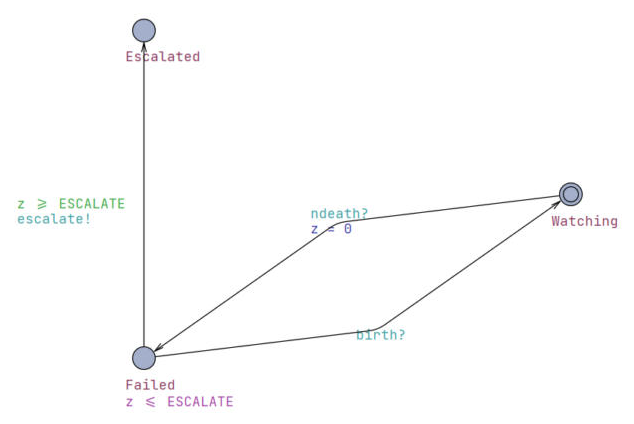

- `Watching` is the normal state. `ndeath?` moves to `Failed` and resets `z`.
- `Failed` has the invariant `z <= ESCALATE`. If the node is not back by then, the only way out
  is `escalate!` to `Escalated`: a ticket for Maintenance (in the code: "container has not
  restarted in 45 s", FC27). If `birth?` arrives first, MON goes back to `Watching`. In the real
  MON, `ndeath?` also makes it halt the band sections of that station; that part is the band model.
- `Escalated` has no way out in the model: the repair by Maintenance is not modelled.
- The query `A[] not MON.Escalated` says the right-hand branch is never needed.

*Why it is its own diagram:* MON is its own container with its own timer. Requirements
THM-REQ-72 and -73 are about what MON sees, so we need MON as a separate observer of the other two.

#### Docker (restart)

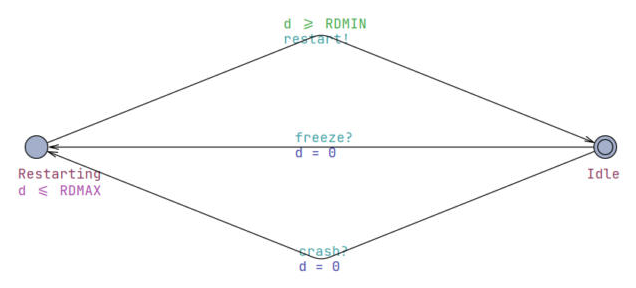

- `Idle` → `Restarting` when the fault happens: `crash?` (the process exits) or `freeze?` (the
  container is paused). Docker does not wait for MON or for the death certificate, as in the code.
- `Restarting` has the invariant `d <= RDMAX` and the guard `d >= RDMIN`, so the restart takes
  between 1 and 30 s. Then `restart!` goes to the node.
- **What it stands for.** After a crash it is Docker's restart policy (`restart: unless-stopped`),
  measured at most 1.19 s in total. After a freeze Docker does nothing: the container has to be
  unpaused, which the experiment does and a plant would leave to Maintenance. So for a freeze the
  1 to 30 s is an assumption about that response, not a property of the code.

*Why it is its own diagram:* Docker is infrastructure, not our code, and the restart time is an
**estimate**. In its own diagram that estimate lives in one place (`RDMIN`, `RDMAX`).

#### Env (the fault)

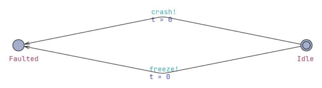

- From `Idle` it can go to `Faulted` with `crash!` or with `freeze!`, and resets the observer
  clock `t`. It can only do it once. UPPAAL tries both choices.

*Why it is its own diagram:* the fault is not a part of the factory. Taking it out of the node
keeps the node clean, and the same system could be tested with a different fault by changing
only this diagram.

**What the queries prove:** a silent node is known to MON within 8 s (so inside the 15 s limit);
the node is back within 60 s; MON never escalates (its 45 s count starts at the death
certificate, and a restart takes at most 30 s plus 1 s to boot); every failure ends in recovery;
no deadlock; and failures and recoveries are reachable.

---

### 5.2 Band (`band.xml`): does a halt reach every upstream station, and is it released safely?

**The story.** Five conveyor sections S1 to S5 carry pans. If the owner of section *k* fails,
that section halts, and everything **upstream** of it must stop taking new pans, otherwise
pans pile up. When the owner is back, MON releases the stopped sections, but only then.

**How the code does it, and how the model differs.** In the code, MON sends Band Transport a
"Section command" (`halt` for all sections owned by the failed station, `run` when that station is
reborn or answers again). BT is one container; it works out the state of every section at once:
a section is halted if it is commanded to halt **or any section downstream of it is**
(`effective` and `haltedBehind` in `internal/bt/bt.go`). So all upstream sections stop in the same
step and run again in the same step. The model instead lets each section take up to 1 s to pass
the halt on, because the requirement allows that (THM-REQ-76 and -78, T-RC3). That is looser than
the code, so what the model proves also holds for the code. The 1 s was not measured.

**Parameters:** `N = 5` sections (index 0 is the most upstream), `HOP = 1` (each section
passes the halt on within 1 s, THM-REQ-76/78), `RDMIN`/`RDMAX = 1/30` (owner restart,
*estimated*). Variables: `hk` (the failed section), `nstopped` (how many are stopped now),
`ownerUp[]`, `faulted`, `released`. `stop[N]` is a sink so section 0 has something to send to.

#### Section (one conveyor section, used five times)

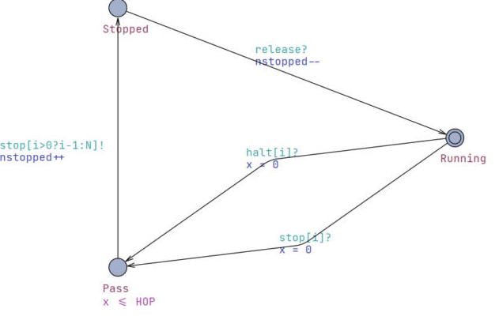

- `Running` is the normal state. It leaves it for `Pass` in two cases: `halt[i]?` (its own owner
  failed) or `stop[i]?` (the section downstream of it has stopped). Both reset the clock `x`.
- `Pass` has the invariant `x <= HOP`: within 1 s the section must hand the stop on to the next
  section upstream, with `stop[i>0?i-1:N]!`. For section 0 the target `N` is the sink. It also adds 1
  to `nstopped`.
- `Stopped` waits for `release?` (the broadcast from MON), subtracts 1 from `nstopped`, and goes
  back to `Running`.

*Why it is its own diagram, and used five times:* all five sections behave the same, and only their
position in the line differs. That position is the parameter `i`, written at the top of the
editor (`const id_t i`). One diagram with a parameter is safer and shorter than five copies.
The chain "halt, pass on, pass on, ..." is created by the channels between the copies, not drawn
anywhere.

#### Env (the owner fails)

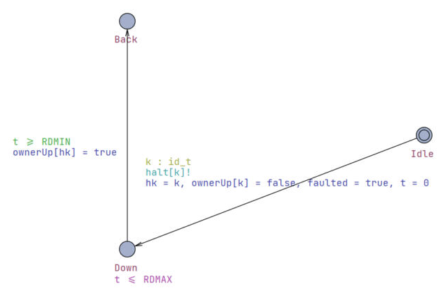

- The arrow `Idle` → `Down` has a **select** (`k : id_t`, olive text): UPPAAL may choose **any**
  section as the one that fails. It sends `halt[k]!` and notes `hk = k`, `ownerUp[k] = false`.
- `Down` lasts between `RDMIN` and `RDMAX` seconds (guard and invariant). Then the owner is back
  (`ownerUp[hk] = true`) and the state is `Back`.
- In the code the halt does not start at the failure itself but when MON has noticed it (death
  certificate or silence). The supervision model covers that time; this model starts after it.

*Why it is its own diagram:* it is the fault source, as in the supervision model. The `select`
lets one small diagram cover all five cases (failure of S1, S2, ..., S5).

#### MON (the release rule)

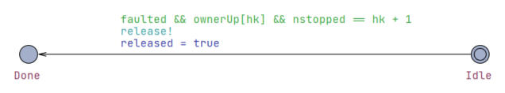

- One edge, with a long guard: `faulted && ownerUp[hk] && nstopped == hk + 1`. MON sends `release!`
  only when (1) a fault happened, (2) the failed owner is back, **and** (3) all the sections
  upstream have confirmed they are stopped.
- Conditions (1) and (2) are the code: MON sends `run` when the station's birth certificate (or its
  heartbeat after a silence) arrives (`onBirth`, `onHeartbeat` in `internal/mon/mon.go`). This is the
  rule T-OR2: a section is released only after its owner is back. Condition (3) is **not** in the
  code; it is an assumption of the model (see section 6). In the code it needs no check, because
  BT derives the upstream halts itself.

*Why it is its own diagram:* the release is a decision of the monitor, not of the sections. Having it in a
separate diagram makes the rule visible as one guard, and the queries
`A[] released imply ownerUp[hk]` and `A[] released imply nstopped == 0` check exactly that guard.

#### Tick

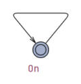

- One state with one arrow to itself and no labels. It does nothing, but it is always possible.
  See section 4: it prevents UPPAAL from calling a finished run a deadlock.

**What the queries prove:** after at most N × HOP = 5 s exactly `hk + 1` sections are stopped
(the failed one and everything upstream); each section passes the stop on within 1 s; the
release never happens before the owner is back; after the release nothing stays stopped; never
more sections stopped than are upstream; release is reachable.

---

### 5.3 Batter (`batter.xml`): can batter wait too long?

**The story.** A batch is mixed (6 s) and inspected (3 s). Then BAT-INSP must hand it to
depositing (THM-DEP). Depositing can be **stopped**: for a jam (FC7, which clears by itself after
30 s in the code), or because a station behind it asks it to stop (the baking zone, the cooling
buffer, the holding area before wrapping, no clean pans), or because the band section S1 is
halted, or because MON is offline. Batter must not wait for ever, so after 25 s (parameter **P3**)
of waiting the batter is discarded.

An important detail: **there is no acknowledgement** from depositing. BAT-INSP never asks "did
you take it?". It keeps its own **copy** of the "depositing stopped / working again" state and
acts on that. If the copy says working, it sends "Batter ready" and is done. This matches the
code (`internal/bat/insp.go`) and is the group decision recorded in `TODO.md` item 7.

**Parameters:** `MIX = 6`, `INSP = 3`, `P3 = 25`, `POLL = 1` (the code looks at the state once
a second, so it really discards after 26 s), `LOST = 120` (dosing gives up on a batch after 120
s), `STALE = 6` (the copy is at most one heartbeat plus one delivery old, *estimated*),
`BLOCKMAX = 60` (depositing stays stopped at most this long, *estimated*: the jam alone is 30 s,
the other stop reasons can last longer), `DEPSTART = 24` (a queued batter waits at most this long
for depositing to take it up: depositing works one batch after another, one pan per second, and a
batch has 24 pans, so a batter that arrives early sits behind the previous batch; from
`PansPerBatch` and `depositTime` in the code). Clocks: `g` age of the batch, `h` time since the inspector approved it.

#### Batch (BAT-INSP's view of one batch)

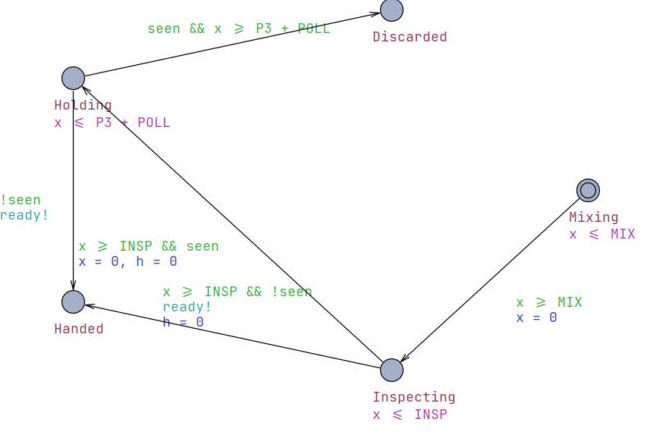

- The batch starts in `Mixing` (6 s) and goes to `Inspecting` (3 s).
- After the inspection there is a fork, decided by `seen`, BAT-INSP's copy of the depositing
  state:
  - `!seen` (depositing works): straight to `Handed`, sending `ready!` (the "Batter ready"
    signal). BAT is done with the batch.
  - `seen` (depositing is stopped): to `Holding`.
- In `Holding` the batter waits. The invariant `x <= P3 + POLL` limits the wait to 26 s. If the
  copy says working again (`!seen`), it goes to `Handed`. If it is still stopped after 26 s, it goes
  to `Discarded`.

*Why it is its own diagram:* it is the part of the batter's life that belongs to BAT-INSP. The
`ready!` arrow is the only place where this diagram touches depositing.

#### Dep (THM-DEP, depositing)

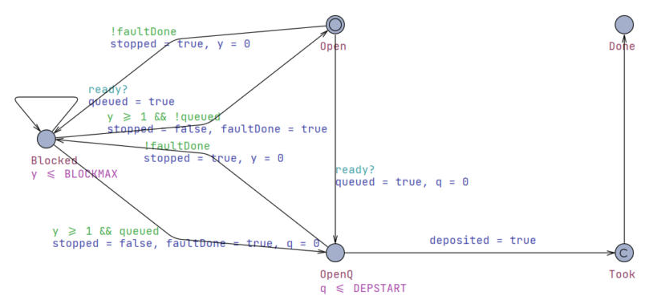

- `Open` (start) means depositing admits pans. `Blocked` means it is stopped; the invariant
  `y <= BLOCKMAX` limits that to 60 s, and the edges back need `y >= 1`. It can stop **only once**
  (`!faultDone`), from `Open` or from `OpenQ`.
- `ready?` is the arrival of the batter. Whatever the state, depositing accepts and **queues** it.
  In `Open` this leads to `OpenQ` (a batter is queued). In `Blocked` it only sets `queued = true`
  (the loop on the left).
- `OpenQ` has the invariant `q <= DEPSTART`: when it is open and has a batter, it takes it up within
  24 s (it may first finish the previous batch).
  `Took` has a `C`, it is committed and only sets `deposited = true`; then `Done`.
- When `Blocked` ends, it goes to `Open` or to `OpenQ` depending on whether a batter was queued
  in the meantime.

*Why it is its own diagram:* it is a different system (THM), with its own failure. BAT must **not**
see it directly. The model keeps them apart, so it cannot cheat by letting BAT read the true state.

#### Copy (the state signal on its way)

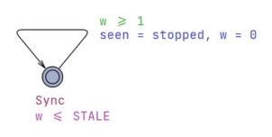

- One state with a loop: every 1 to 6 s (`w >= 1`, invariant `w <= STALE`) it copies the real
  state to what BAT-INSP believes: `seen = stopped`.
- This is the "Depositing stopped / working again" state signal, which is repeated with every
  heartbeat. So BAT-INSP's picture of depositing is **at most 6 s old**.

*Why it is its own diagram:* it is not a station; it is a message path. Putting the delay in its
own diagram makes the staleness an explicit, tunable value. The first finding below
comes from this diagram.

**What the queries prove:** before the handoff the batter holds at most 26 s; BAT's side of a
batch is finished within 35 s; a batter is always deposited before dosing gives the batch up
(120 s); deposited and discarded never both happen; both ends are reachable.

**Two findings** (satisfied queries that show a weakness rather than a safety guarantee):

1. The state copy can be stale: a batter can be handed over while depositing is already
   stopped. Depositing queues it, so nothing is lost.
2. After the handoff **nothing limits the wait**: a batter can be deposited up to 108 s after
   approval (24 s behind the previous batch, a stop of up to 60 s, 24 s again), longer than P3.
   That is only 3 s before dosing gives the batch up at 120 s (9 s of mixing and inspection plus
   108 s). The 25 s rule is only enforced before the handoff. This is documented in
   `docs/team-review.md` section 3, item 11, with a proposed fix.

---

### 5.4 Handover (`handover.xml`): is a lost message harmless?

**The story.** Station A finishes a pan, **stores a document** (the truth) and then sends a
message (the trigger) to station B. The message may be lost (the signals use QoS 1 and persistent
sessions, so this is rare, but a receiver that was down misses it). Station B also **scans** the
documents every 5 seconds, and at start, and takes up any that are older than a 3 s grace period.
So even a lost message cannot lose a pan.

**Parameters:** `GRACE = 3`, `RECONCILE = 5` (both from the code), `DELMAX = 1` (message
delay, *estimated*). Clock `a`: time since the document was stored.

#### Sender (the station that finishes the pan)

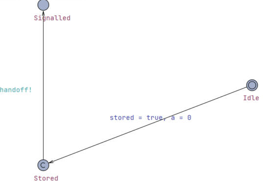

- `Idle` → `Stored`: the document is written (`stored = true`) and the clock `a` starts. `Stored`
  is **committed** (the `C`), so no time passes before the next step.
- `Stored` → `Signalled`: only now `handoff!` is sent. The order is therefore always
  document first, message second (rule T-OR1).

*Why it is its own diagram:* it is the behaviour of the first station. It does not know whether
the message arrives; it just does its two steps in the right order.

#### Message (the network)

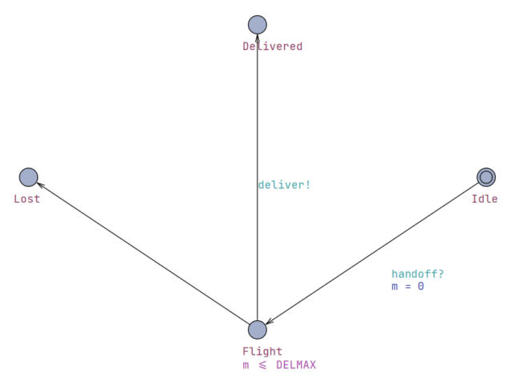

- `handoff?` puts the message `Idle` → `Flight` and starts the clock `m`. The invariant
  `m <= DELMAX` limits the flight to 1 s.
- From `Flight` two arrows leave and **both are possible**: `deliver!` to `Delivered`, or
  silently to `Lost` (no label: nothing is sent to anyone).

*Why it is its own diagram:* the network is not owned by either station. Giving it a separate diagram
with a "lost" branch lets UPPAAL examine the bad case on purpose. If the loss were hidden in
the sender, it would be easy to forget.

#### Receiver (the next station)

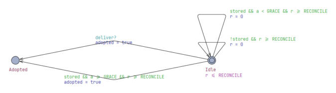

*This picture is zoomed out so that the long labels fit.*

- `Idle` has the invariant `r <= RECONCILE`: at least every 5 s the station scans the documents.
- `deliver?` → `Adopted` at once: the message arrived, take up the document.
- The long arrow at the bottom is the safety net: at a scan (`r >= RECONCILE`), if a document is
  stored and older than the grace period (`a >= GRACE`), it is adopted even though no message
  came.
- The two loops on the right are scans that find nothing to do: either there is no document yet
  (`!stored`) or it is still too new (`a < GRACE`). They reset `r`.

*Why it is its own diagram:* it is the second station, and it has two ways to learn about a
pan: the message and its own scan. The safety net is only credible if the receiver does not need
the sender or the message to work.

**What the queries prove:** a stored document is always taken up within GRACE + RECONCILE = 8 s
(worst case: a scan just before the grace period ends, then another one 5 s later), also when
the message is lost; and both the "lost then reconciled" and the "delivered" paths exist.

---

## 6. What the results mean, and their limits

| Model | Queries | Result |
|---|---|---|
| `supervision.xml` | 8 | all satisfied |
| `band.xml` | 7 | all satisfied |
| `batter.xml` | 11 | all satisfied (two of them are the findings above) |
| `handover.xml` | 4 | all satisfied |

**What this gives us.** For the modelled parts, the timing claims hold for **every** possible
behaviour within the stated parameters, not only for the runs we happened to try. The
measured experiment (`docs/experiment.md`) fits inside the proven bounds: detection at most
7.06 s against a proven 8 s, recovery at most 1.19 s against a proven 60 s.

**What it does not give us.**

- The models are written **by hand** from the code and the documents. They can drift from the
  code. They are not generated from it, and the UPPAAL check is **not part of the CI**.
- Each model has **one fault** (one node, one halt, one batch). Several failures at once are
  not covered.
- Some details of the code are simplified or left out: after a freeze the restart delay is an
  assumed response time, not code (section 5.1), MON's own watchdog is not modelled, the band halt
  takes up to 1 s per section where the code is instant, and the release waits for all upstream
  sections to be stopped, which the code does not need (section 5.2). The watchdog and the band
  halt make the model slower than the code, so they are on the safe side; the other two are
  assumptions that are not in the code.
- Estimated values (restart time, message delay, how long depositing may stay stopped) are
  assumptions. The proofs hold for those values only. They are safe, not tight.
- A model is an abstraction. For example, the batter model does not include the delivery
  delay of "Batter ready"; a message lost for good is caught by dosing's 120 s timer, which
  is only checked as a query, not modelled.
- "Satisfied" means the claim holds **in the model**. It does not prove the code is correct.

---

## 7. How to open, run and change the models

**Check all models from the command line** (UPPAAL's command-line verifier; no GUI needed):

```bash
node gen.js
verifyta -q supervision.xml supervision.q
verifyta -q band.xml band.q
verifyta -q batter.xml batter.q
verifyta -q handover.xml handover.q
```

On Windows `verifyta` is at `C:\Program Files\UPPAAL-5.0.0\app\bin\verifyta.exe`. Every line
should say `Formula is satisfied`.

**Look at the diagrams:** open the `.xml` in the UPPAAL GUI (click *Import* when it asks about
the query file). The *Editor* tab shows the templates; the *Verifier* tab runs the queries.
To see one automaton, click its name in the project tree on the left (drag the splitter to
widen it).

**Change a model:** edit `gen.js`, never the `.xml`, then run `node gen.js`.

> **Do not save from the UPPAAL GUI.** It overwrites the generated files with its own layout
> and format, and the next `node gen.js` is the only way back. If it happens,
> `git checkout -- <file>` and regenerate.

Files:

| File | What it is |
|---|---|
| `gen.js` | The generator: all constants, templates, positions and queries live here. |
| `*.xml` | Generated models (open in UPPAAL). |
| `*.q` | Generated query files. |

Related documents: `docs/timing-constraints.md` (D1, which rules exist), `docs/verification-scope.md`
(D2, what we verify and why), `docs/timed-automata.md` (D3, the same automata as tables),
`docs/team-review.md` (open decisions).

---

## 8. Glossary

| Term | Meaning |
|---|---|
| **NTA** | Network of timed automata: several templates that talk through channels. |
| **Template** | One automaton, usually one part (a station, the broker, the monitor). |
| **Location / state** | A circle in the diagram. |
| **Edge / transition** | An arrow. |
| **Clock** | A stopwatch variable that only grows and is reset by updates. |
| **Invariant** | A condition a location needs to stay in; forces the automaton to leave in time. |
| **Guard** | A condition an edge needs to be taken; holds the move back. |
| **Channel** | A named message line between automata; `!` sends, `?` receives. |
| **Broadcast channel** | A channel with one sender and any number of receivers; the sender never waits. |
| **Committed location** | A location where time may not pass; used for steps that happen instantly. |
| **Deadlock** | A state from which nothing can ever happen again. |
| **Query** | A claim about the model that UPPAAL checks (`A[]`, `E<>`, `-->`). |
| **Negative control** | Changing a number to make a query fail, to show that the query can fail. |
| **Heartbeat** | A "still alive" message every 5 s. |
| **Birth / death certificate** | The message a node sends when it starts / the message the broker sends when it disappears. |
| **Last Will** | The MQTT feature that carries the death certificate: a station registers it when it connects and the broker publishes it when the connection ends. |
| **Keep-alive** | An MQTT ping every 5 s; the broker declares a station dead after 1.5 × 5 s without traffic. |
| **Crash / freeze** | The process dies (noticed at once) / the container is paused and goes silent (noticed after the keep-alive timeout). |
| **MON** | The monitor system. |
| **Estimated** | A value the plant does not give; chosen by the group and marked as such. |
